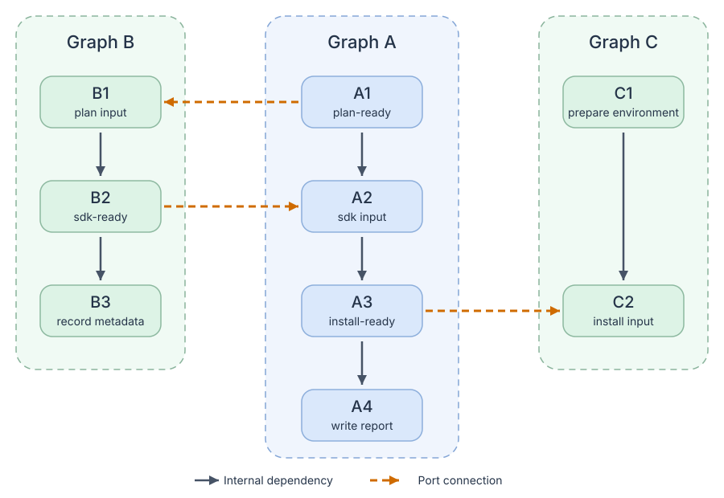

# Rivlet

English | [简体中文](https://github.com/ririv/rivlet/blob/main/README.zh-CN.md)

Rivlet is a Python library for composing and running task graphs, with a Rust
execution core. Write your tasks as Python functions, connect them explicitly,
and reuse whole workflows as subgraphs.

Use it for build pipelines, automation, data processing, or validation workflows
that need clear dependencies and controlled concurrency. It runs inside your
application; it is not a distributed workflow service.

## What you can do

- **Compose steps and subgraphs:** use `>>` for ordering and `|` for independent
  branches, without flattening reusable subgraphs.
- **Connect readiness ports:** let a consumer prepare early and wait only where
  it actually needs a provider's output, not for the provider's entire workflow.
- **Make data flow explicit:** bind step results to action and condition arguments
  through result edges; order-only dependencies need no result passing.
- **Apply conditions where they belong:** prune optional work before execution,
  skip a step based on runtime results, or condition only a dependency.
- **Mix synchronous and asynchronous tasks:** choose blocking or awaitable entry
  points, with managed or borrowed thread pools. Runtime-created subgraphs reuse
  the execution's Python resources.
- **Inspect what happened:** render graphs, query results, and subscribe to typed
  execution events. A failed step blocks dependent work while independent branches
  continue; the overall run still reports failure.

## Install

Requires Python 3.12 or later:

```bash
pip install rivlet
```

Prebuilt wheels are available for CPython 3.12–3.15 on Linux x86_64 (glibc 2.28+),
macOS arm64 (macOS 11+), and Windows x64. These installations need no Rust toolchain.
Other platforms require a source build; see
[distribution support](https://github.com/ririv/rivlet/blob/main/docs/releasing.md).
For Windows x64 source builds and installed-wheel validation, see
[Windows setup](https://github.com/ririv/rivlet/blob/main/docs/development.md#windows-setup).

## Compose steps and reusable subgraphs

```python
from rivlet import Graph, Step, run

validate = Step(lambda: print("validate"), label="validate")
test = Step(lambda: print("test"), label="test")
checks = (validate | test).graph(label="checks")
prepare = Step(lambda: print("prepare"), label="prepare")
finish = Step(lambda: print("finish"), label="finish")
workflow = (prepare >> checks >> finish).graph(label="example")
run(workflow, max_workers=2)
```

After prepare, validate and test can run concurrently; finish waits for both.
`>>` orders nodes, while `|` adds no dependency. `max_workers` limits synchronous Python
threads, not the number of coroutine tasks.

`.graph()` materializes the wiring declaration; step actions run only during
execution. Use ordinary functions returning Graph for parameterized composition.

Step executes a callable; Graph contains a substructure. Both own identity, label
and condition and support the same wire/DSL operations. Node is their common
protocol, not another wrapper. Only Graph exposes an interface.

GraphStructure holds reusable structure without a node identity. Declare distinct
Graph nodes to use one structure twice:

```python
from rivlet import run

body = checks.structure
left = Graph(body, label="left")
right = Graph(body, label="right")
both = (left | right).graph(label="both")
run(both, max_workers=2)
```

The two Graph nodes share structure, not mounted results or paths. The DSL retains
actual nodes; the same node cannot occur twice in one structure. Execution accepts
the actual Step or Graph root, without wrapping a Graph in a Step. Create another
Execution to run a declaration again. For direct construction, see the
[core model](https://github.com/ririv/rivlet/blob/main/docs/core_model.md).
For complete examples showing when a subgraph is declared versus returned by an action,
see [subgraph execution](https://github.com/ririv/rivlet/blob/main/docs/execution.md#declared-versus-runtime-returned-subgraphs).

## Manage resources or borrow your own

`run(workflow, max_workers=4)` creates and closes its Python thread pool. In an async
function, use `await arun(workflow, max_workers=4)` to reuse the caller's event loop.
Both can execute the same mixture of synchronous and coroutine actions.

Applications with an existing same-interpreter thread pool can use the lower-level
entry point without transferring ownership:

```python
from concurrent.futures import ThreadPoolExecutor

from rivlet import Execution

with ThreadPoolExecutor(max_workers=4) as pool:
    execution = Execution(workflow)
    execution.run(pool=pool)
```

Use `await execution.arun(pool=pool)` in an async function. Rivlet waits for its own
work to exit but never closes a borrowed pool. There is no implicit graph-wide coroutine
quota. To bound in-flight actions in a subtree without creating another pool, pass
`max_concurrency={workflow: 4, checks: 2}` to either managed or borrowed execution.
The limits cover Python, coroutine and Rust actions using the graph's actual nesting.
Process and isolated-interpreter pools
are not interchangeable with this shared-memory execution model. See
[execution resources](https://github.com/ririv/rivlet/blob/main/docs/execution.md#managed-and-borrowed-execution-resources)
and [subtree limits](https://github.com/ririv/rivlet/blob/main/docs/execution.md#optional-subtree-concurrency-limits).

## Connect subgraphs through input and output ports

Sometimes a downstream workflow needs only one intermediate result, not the
completion of an entire upstream subgraph. A port names that readiness
contract. Its output identifies the step that makes it ready; its input identifies
where the consumer starts needing it.

Graph A and B can even collaborate in both directions: A publishes a plan,
B prepares an SDK, then A continues. Graph C consumes A's installed result.
The arrows below connect specific steps, not whole-graph completion:



```python
from rivlet import Edge, Graph, GraphInterface, GraphStructure, Step, run

plan_ready = "plan-ready"
sdk_ready = "sdk-ready"
install_ready = "install-ready"

plan = Step(lambda: print("A1: publish plan"), label="A1")
configure = Step(lambda: print("A2: use SDK"), label="A2")
install = Step(lambda: print("A3: install"), label="A3")
app_report = Step(lambda: print("A4: write report"), label="A4")
app = (plan >> configure >> install >> app_report).graph(
    label="Graph A",
    interface=GraphInterface(
        inputs={sdk_ready: configure},
        outputs={plan_ready: plan, install_ready: install},
    ),
)

receive = Step(lambda: print("B1: receive plan"), label="B1")
prepare_sdk = Step(lambda: print("B2: prepare SDK"), label="B2")
sdk_report = Step(lambda: print("B3: record metadata"), label="B3")
sdk = (receive >> prepare_sdk >> sdk_report).graph(
    label="Graph B",
    interface=GraphInterface(
        inputs={plan_ready: receive},
        outputs={sdk_ready: prepare_sdk},
    ),
)

prepare_environment = Step(lambda: print("C1: prepare environment"), label="C1")
consume = Step(lambda: print("C2: use installed result"), label="C2")
consumer = (prepare_environment >> consume).graph(
    label="Graph C",
    interface=GraphInterface(inputs={install_ready: consume}),
)

pipeline = Graph(
    GraphStructure(
        nodes=(sdk, app, consumer),
        edges=(
            Edge(app, sdk, ports=plan_ready),
            Edge(sdk, app, ports=sdk_ready),
            Edge(app, consumer, ports=install_ready),
        ),
    ),
    label="pipeline",
)
run(pipeline, max_workers=3)
```

The cross-graph chain is `A1 → B1 → B2 → A2 → A3 → C2`; the full workflow is
not one sequential chain:

- C1 can prepare independently, while C2 waits for both C1 and A3.
- A2 needs B2's SDK, not B3's metadata: A2 and B3 can run concurrently.
- C2 needs A3's installed result, not A4's report: C2 and A4 can run concurrently.

A4 and B3 do not modify the already-published artifacts. Graph-level collaboration
goes both ways, but the actual step dependencies are acyclic. The overall run
still waits for all three subgraphs, including their reporting steps, to finish.

Matching port names do **not** create dependencies: `Edge` explicitly
connects the selected subgraphs. An ordinary port edge synchronizes readiness without passing values.
Use result edges with typed interface endpoints for argument passing, and publish an output only when later steps will no longer
invalidate what the consumer reads.

This is different from `app >> sdk`, which would wait for all of A before
starting B and is not interchangeable with the plan port edge. For selecting among providers,
multiple inputs, and failure behavior, see
[interface ports](https://github.com/ririv/rivlet/blob/main/docs/interfaces.md).

### Use an anonymous endpoint for the common case

No name is required when a direction exposes only one endpoint:

```python
from rivlet import Edge, GraphInterface, Step

compile_code, install = Step(lambda: print("compile")), Step(lambda: print("install"))
configure, launch = Step(lambda: print("configure")), Step(lambda: print("launch"))
source = (compile_code >> install).graph(interface=GraphInterface(outputs=install))
target = (configure >> launch).graph(interface=GraphInterface(inputs=configure))
edge = Edge(source.interface.output, target.interface.input)
```

Anonymous and named endpoints can coexist,
for example `outputs={None: install, "report": write_report}`. `.output` is exactly
`.outputs[None]`, not an automatic choice of a sole named output. See the
[complete mixed example](https://github.com/ririv/rivlet/blob/main/docs/interfaces.md#anonymous-and-named-endpoints).

### Forward an interface when wrapping a subgraph

Using `app` from the previous example:

```python
setup = Step(lambda: print("set up producer"), label="setup")
wrapped = (setup >> app).graph(interface=app)
```

`interface=app` explicitly exposes the child's input and output
ports on the wrapper. Omit it and the wrapper exposes no ports. You can forward
only one direction or declare a new interface with `GraphInterface`.

## Use conditions

| What you want | API | When the condition is false |
| --- | --- | --- |
| Exclude optional work before execution | `StaticConditions.when(...)` | Remove the node and its incident edges during compilation |
| Decide whether a task runs | `Step(condition=predicate)` / `Graph(condition=predicate)` or `condition=(predicate, source, ...)` | Skip its action; a subgraph is not entered |
| Decide whether a task waits for another | `ConditionalPrerequisite(...)` | Remove only that waiting requirement, not either task |

### Static conditions: choose work before execution

```python
from rivlet import Execution, StaticCondition, StaticConditions, Step, run

extra_checks = StaticCondition(payload=False, description="extra checks enabled")
static = StaticConditions(evaluator=lambda condition: condition.payload is True)

prepare = Step(lambda: print("prepare static workflow"), label="prepare")
verify = Step(lambda: print("verify"), label="verify")
extra = Step(lambda: print("extra checks"), label="extra")
finish = Step(lambda: print("finish static workflow"), label="finish")

graph = (prepare >> (verify | static.when(extra_checks, extra)) >> finish).graph(
    label="static conditions",
)
run(graph, max_workers=2)
```

With `payload=False`, compilation removes `extra`; change it to `True` to include
it alongside `verify`. The application defines the payload and its evaluator;
Rivlet does not embed its own feature or platform rules.

Static pruning does not reconnect a removed node's predecessors and successors.
Here the always-present `prepare → verify → finish` path preserves the required
ordering. Static conditions also do not defer Python construction of a child graph.

### Static selection: retain candidates, select exactly one

```python
from rivlet import Case, Execution, Step, run, static

platform = "android"
version = 3
prepare = Step(lambda: print("prepare"), label="prepare")
modern = Step(lambda: print("modern Android"), label="modern")
legacy = Step(lambda: print("legacy Android"), label="legacy")
linux = Step(lambda: print("Linux"), label="linux")
finish = Step(lambda: print("finish"), label="finish")

graph = (
    prepare
    >> static.select(
        cases=(
            Case(platform == "android" and version >= 3, modern),
            Case(platform == "android" and version < 3, legacy),
            Case(platform == "linux", linux),
        ),
    )
    >> finish
).graph(label="static selection")
run(graph)
```

Each `Case(condition, component)` contains one complete boolean condition and a
Step or Graph. A Graph is already a node; pass it directly.
Declaration rendering retains every case; compilation requires exactly
one true condition and produces `prepare → modern → finish`. Zero or multiple active
cases are errors, not first-match precedence. `static` is the module namespace and
requires no evaluator. Python computes the booleans at construction; compilation
checks the selection. See [static selection](https://github.com/ririv/rivlet/blob/main/docs/static_selection.md)
for subgraphs, boundaries, and direct declarations.

### Passing results to an action

```python
from rivlet import Execution, Graph, NodeRunContext, Option, Results, Step, run

prepare = Step(lambda: print("prepare"))
plan = Step(lambda: "implementation plan")
review = Step(lambda: True)


def implement(
    ctx: NodeRunContext, plan: Option[object], review: Option[object]
) -> None:
    ctx.control.require_running()
    print(plan.unwrap(), review.unwrap())


work = Step(implement)
graph = Graph.from_wiring(
    (
        prepare.wire(),
        plan.wire(),
        review.wire(),
        work.wire(after=(prepare, Results(plan, review))),
    )
)
run(graph)
```

`after` lists both kinds of prerequisite: a plain Node only waits for completion;
`Results(plan, review)` also passes their results in that order. For direct construction,
the equivalent edges are `Edge(prepare, work)` and `*Edge.results((plan, review), work)`.
Skipped producers supply `Nothing()`; a successful `None` is `Some(None)`.
Failed producers block the consumer. Result edges can also use
`producer.interface.outputs[name]` and `consumer.interface.inputs[name]` across
subgraphs; see the complete [port result example](https://github.com/ririv/rivlet/blob/main/docs/interfaces.md#result-transport).

### Runtime conditions: decide from a step result

```python
from rivlet import Execution, Graph, Option, Step, run


def should_process(result: Option[object]) -> bool:
    return result.unwrap() is True


probe = Step(lambda: False, label="has work")
process = Step(
    lambda: print("process work"),
    label="process",
    condition=(should_process, probe),
)
done = Step(lambda: print("workflow finished"), label="done")

graph = Graph.from_wiring(
    (
        probe.wire(),
        process.wire(),
        done.wire(after=(process,)),
    ),
    label="runtime conditions",
)
run(graph)
```

`condition=(should_process, probe)` declares the result dependency and passes it as
an `Option`; there is no second `after=(probe,)` to maintain. The tuple is flat:
`(predicate, source_a, source_b, ...)`, with no fixed maximum number of sources.
With no inputs, pass the predicate directly, for example `condition=lambda: True`.
These are lightweight condition declarations, not extra Steps. Because the probe
returns `False`, `process` is skipped and `done` still runs. Return `True` to run
`process`. A skipped action produces no result; an action returning `None` produces
`Some(None)`. If a source may be skipped, inspect `is_some()` or `is_none()` before
unwrapping. A predicate error blocks the affected task; it is not treated as false.

For a subgraph, pass the same condition to `Graph(structure, condition=...)`.

### Conditional edges: decide whether to wait

```python
from rivlet import ConditionalPrerequisite, Execution, Graph, Step, run

decision = Step(lambda: False, label="wait for checks")
checks = Step(lambda: print("run checks"), label="checks")
publish = Step(lambda: print("publish"), label="publish")
wait_for_checks = lambda result: result.unwrap() is True

graph = Graph.from_wiring(
    (
        decision.wire(),
        checks.wire(),
        publish.wire(
            after=(
                ConditionalPrerequisite(
                    checks,
                    condition=(wait_for_checks, decision),
                ),
            ),
        ),
    ),
    label="conditional dependency",
)
run(graph, max_workers=2)
```

`publish` waits for `decision`. If it returns `True`, `publish` also waits for
`checks`; if it returns `False`, `checks` still runs, but publishing need not wait
for it. Both tasks remain part of the overall run. To skip publishing itself,
declare it with `Step(..., condition=...)` instead. Static edge conditions are available
through `static.edge(source, target, condition=...)`.

## Export structure without running tasks

```python
import json

from rivlet import Execution, Step, export_graph, run

graph = (
    Step(lambda: None, label="prepare") >> Step(lambda: None, label="finish")
).graph()
execution = Execution(graph)
declaration = export_graph(graph)
compilation = execution.compile()
compiled = export_graph(compilation)
json.dumps({"declaration": declaration, "compiled": compiled})
run(execution)  # reuses the same compilation
```

The versioned JSON document preserves mounted IDs, subgraph boundaries, typed edges,
conditions, and interface ports. Declaration inspection evaluates no host code;
compiled export reads existing decisions without recompiling. Runtime events and
results stay separate. See [structural export](https://github.com/ririv/rivlet/blob/main/docs/graph_export.md)
for the schema, historical snapshots, and static/dynamic scope limits.

## Explore more

- [Result inputs and action context](https://github.com/ririv/rivlet/blob/main/docs/core_model.md#results-and-runtime-context)
- [Conditional steps](https://github.com/ririv/rivlet/blob/main/docs/conditional_steps.md) and [conditional edges](https://github.com/ririv/rivlet/blob/main/docs/conditional_edges.md)
- [Async execution, cancellation, and failure propagation](https://github.com/ririv/rivlet/blob/main/docs/execution.md)
- [Typed failure events](https://github.com/ririv/rivlet/blob/main/docs/failure_events.md)
- [All documentation](https://github.com/ririv/rivlet/blob/main/docs/index.md)

For contributors: [local development and checks](https://github.com/ririv/rivlet/blob/main/docs/development.md),
[architecture](https://github.com/ririv/rivlet/blob/main/docs/rust-architecture.md),
and [releasing](https://github.com/ririv/rivlet/blob/main/docs/releasing.md).

## License

This project is licensed under the [MIT License](https://github.com/ririv/rivlet/blob/main/LICENSE).
