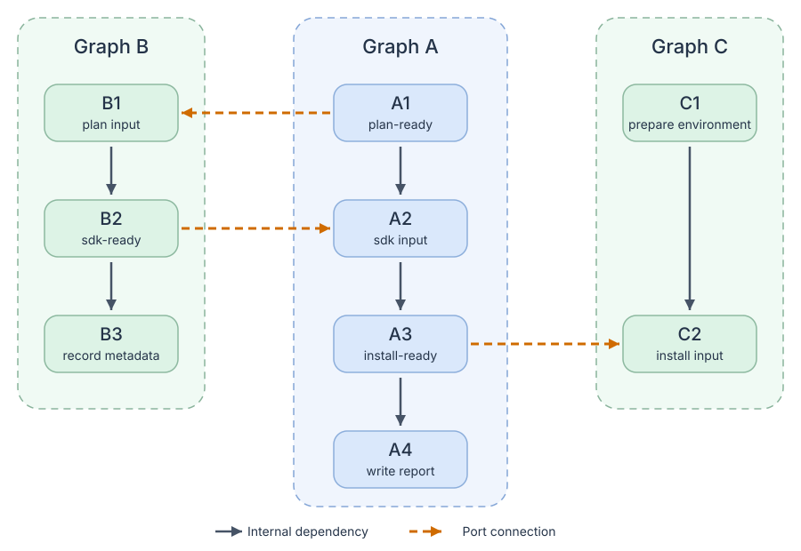

# Rivlet

[English](https://github.com/ririv/rivlet/blob/main/README.md) | 简体中文

Rivlet 是一个用于组合和执行任务图的 Python 库，执行核心由 Rust 实现。
把任务写成 Python 函数，显式连接依赖，再把完整工作流作为子图复用。

适合需要清晰依赖和可控并发的构建流水线、自动化、数据处理与校验工作流。
它运行在你的应用进程内，不是分布式工作流服务。

## 可以做什么

- **组合步骤与子图**：用 `>>` 表达先后依赖，用 `|` 组合独立分支，复用时保留子图边界。
- **通过出入口同步就绪状态**：消费者可以提前准备，只在真正需要提供方产出的位置等待，
  不必等提供方的整个工作流结束。
- **显式表达数据流**：用结果边把步骤返回值绑定到 action 或条件函数的参数；
  只需执行顺序的依赖不用传递结果。
- **在对应位置声明条件**：执行前裁剪可选任务，根据运行结果跳过步骤，或只对某条依赖设置条件。
- **混合同步与异步任务**：选择阻塞或可等待入口，可托管或借用线程池；运行时创建的
  子图复用当次执行的 Python 资源。
- **查看执行过程**：渲染图、查询结果、订阅强类型执行事件。步骤失败只阻断相关下游，
  无关分支继续运行，整次执行最终仍会报告失败。

## 安装

需要 Python 3.12 或更高版本：

```bash
pip install rivlet
```

CPython 3.12–3.15 在 Linux x86_64（glibc 2.28+）、macOS arm64（macOS 11+）和
Windows x64 上提供预编译 wheel，安装这些 wheel 不需要 Rust 工具链。其它平台需要从源码构建，见
[交付范围](https://github.com/ririv/rivlet/blob/main/docs/zh-CN/releasing.md)。
Windows x64 的源码构建与安装后验收见
[Windows 环境](https://github.com/ririv/rivlet/blob/main/docs/zh-CN/development.md#windows-环境)。

## 组合步骤与可复用子图

```python
from rivlet import Graph, Step, run

validate = Step(lambda: print("validate"), label="validate")
test = Step(lambda: print("test"), label="test")
checks = (validate | test).graph(label="checks")
prepare = Step(lambda: print("prepare"), label="prepare")
finish = Step(lambda: print("finish"), label="finish")
workflow = (prepare >> checks >> finish).graph(label="example")
run(workflow, max_workers=2)
```

prepare 完成后，checks 中的 validate/test 可并发执行；finish 等待两者成功。
`>>` 表示先后，`|` 不添加依赖。`max_workers` 限制同步 Python 线程数，不限制协程数量。

`.graph()` 将接线声明物化成图；步骤动作仍只在执行时运行。
需要参数化组合时，使用返回 Graph 的普通函数。

Step 是执行函数的节点，Graph 是包含子结构的节点。二者都持有身份、label 和
condition，并支持相同的 wire/DSL 操作。Node 只是共同协议，不需要手动包装；
只有 Graph 有 interface。

GraphStructure 保存可复用结构，不持有节点身份。复用时显式创建两个 Graph：

```python
from rivlet import run

body = checks.structure
left = Graph(body, label="left")
right = Graph(body, label="right")
both = (left | right).graph(label="both")
run(both, max_workers=2)
```

两个 Graph 共享结构，但挂载路径和结果独立。DSL 保留传入节点，不能在同一结构里
重复放入同一节点对象。Execution 接收实际 Step/Graph 根，不用 Step 再包装 Graph。
声明再次运行时新建 Execution。非 DSL 写法见
[核心模型](https://github.com/ririv/rivlet/blob/main/docs/zh-CN/core_model.md)。
子图应该提前声明，还是由 action 运行时返回，完整对比示例见
[子图执行](https://github.com/ririv/rivlet/blob/main/docs/zh-CN/execution.md#声明子图与动态子图对比)。

## 托管资源或借用已有资源

`run(workflow, max_workers=4)` 创建并关闭自己的 Python 线程池；在 async 函数中用
`await arun(workflow, max_workers=4)`，复用调用方的事件循环。两种入口都能运行同一张
包含同步与协程动作的图。

应用已有同解释器线程池时，可使用低阶入口，资源所有权不转移：

```python
from concurrent.futures import ThreadPoolExecutor

from rivlet import Execution

with ThreadPoolExecutor(max_workers=4) as pool:
    execution = Execution(workflow)
    execution.run(pool=pool)
```

在 async 函数中使用 `await execution.arun(pool=pool)`。Rivlet 等待本次工作退出，
但从不关闭借入的池。不隐式设置全图协程额度。需要限制子图在途动作时，可向高阶或
低阶入口传 `max_concurrency={workflow: 4, checks: 2}`，不需要另建池；Python、协程与
Rust action 根据真实图的嵌套关系共同计数。进程池和独立
解释器池不能直接替换这里的共享内存执行模型。详见
[执行资源](https://github.com/ririv/rivlet/blob/main/docs/zh-CN/execution.md#托管与借用执行资源)
及[子图并发上限](https://github.com/ririv/rivlet/blob/main/docs/zh-CN/execution.md#可选的子图并发上限)。

## 用出入口连接子图

有时下游只需要上游的某项中间产出，不需要等待整个上游子图结束。
端口（`str`）为这项就绪契约命名：出口指向让它就绪的步骤，入口指向消费者
开始需要它的步骤。

Graph A、B 还可以双向协作：A 先公开计划，B 准备 SDK，再让 A 继续；Graph C
消费 A 的安装结果。图中的箭头连接具体步骤，而不是等待整个子图完成：



```python
from rivlet import Edge, Graph, GraphInterface, GraphStructure, Step, run

plan_ready = "plan-ready"
sdk_ready = "sdk-ready"
install_ready = "install-ready"

plan = Step(lambda: print("A1: publish plan"), label="A1")
configure = Step(lambda: print("A2: use SDK"), label="A2")
install = Step(lambda: print("A3: install"), label="A3")
app_report = Step(lambda: print("A4: write report"), label="A4")
app = (plan >> configure >> install >> app_report).graph(
    label="Graph A",
    interface=GraphInterface(
        inputs={sdk_ready: configure},
        outputs={plan_ready: plan, install_ready: install},
    ),
)

receive = Step(lambda: print("B1: receive plan"), label="B1")
prepare_sdk = Step(lambda: print("B2: prepare SDK"), label="B2")
sdk_report = Step(lambda: print("B3: record metadata"), label="B3")
sdk = (receive >> prepare_sdk >> sdk_report).graph(
    label="Graph B",
    interface=GraphInterface(
        inputs={plan_ready: receive},
        outputs={sdk_ready: prepare_sdk},
    ),
)

prepare_environment = Step(lambda: print("C1: prepare environment"), label="C1")
consume = Step(lambda: print("C2: use installed result"), label="C2")
consumer = (prepare_environment >> consume).graph(
    label="Graph C",
    interface=GraphInterface(inputs={install_ready: consume}),
)

pipeline = Graph(
    GraphStructure(
        nodes=(sdk, app, consumer),
        edges=(
            Edge(app, sdk, ports=plan_ready),
            Edge(sdk, app, ports=sdk_ready),
            Edge(app, consumer, ports=install_ready),
        ),
    ),
    label="pipeline",
)
run(pipeline, max_workers=3)
```

跨图主链是 `A1 → B1 → B2 → A2 → A3 → C2`，但完整工作流不是一条串行链：

- C1 可以独立准备，C2 同时等待 C1 和 A3。
- A2 只需要 B2 的 SDK，不需要 B3 的元数据，所以 A2 与 B3 可以并行。
- C2 只需要 A3 的安装结果，不需要 A4 的报告，所以 C2 与 A4 可以并行。

A4、B3 不会再修改已经公开的产物。子图之间虽然有往返协作，具体步骤依赖仍然无环。
整次执行仍会等待三个子图及其报告步骤全部结束。

端口名称相同**不会自动建立依赖**，示例用 `Edge` 显式连接提供方与消费者。
普通端口边只同步就绪；跨图传参使用结果边和实际 interface 端点。
声明出口时，必须保证后续步骤不会再使消费者读取的内容失效。

这与 `app >> sdk` 不同：后者会等整个 A 完成后才开始 B，不能用它替换计划端口边。
多个提供方的选择、多个入口和失败行为见
[端口依赖与子图端口](https://github.com/ririv/rivlet/blob/main/docs/zh-CN/interfaces.md)。

### 常见场景使用匿名端点

每个方向只公开一个端点时，可以不命名：

```python
from rivlet import Edge, GraphInterface, Step

compile_code, install = Step(lambda: print("compile")), Step(lambda: print("install"))
configure, launch = Step(lambda: print("configure")), Step(lambda: print("launch"))
source = (compile_code >> install).graph(interface=GraphInterface(outputs=install))
target = (configure >> launch).graph(interface=GraphInterface(inputs=configure))
edge = Edge(source.interface.output, target.interface.input)
```

匿名与具名端点可以共存，例如
`outputs={None: install, "report": write_report}`。`.output` 就是 `.outputs[None]`，
不是自动选择唯一具名出口。参见[完整混用示例](https://github.com/ririv/rivlet/blob/main/docs/zh-CN/interfaces.md#匿名端点与具名端点)。

### 包装子图时转发接口

沿用上例的 `app`：

```python
setup = Step(lambda: print("set up producer"), label="setup")
wrapped = (setup >> app).graph(interface=app)
```

`interface=app` 显式把内部子图的出入口公开到外层；不写时，外层不公开
任何端口。需要时也可以通过 `GraphInterface` 只转发一个方向，或声明新接口。

## 按条件执行与等待

| 想做什么 | API | 条件为假时 |
| --- | --- | --- |
| 执行前排除可选任务 | `StaticConditions.when(...)` | 编译时移除节点及关联边 |
| 决定任务是否执行 | `Step(condition=predicate)` / `Graph(condition=predicate)` 或 `condition=(predicate, source, ...)` | 跳过 action；对子图则不进入内部 |
| 决定任务是否等待某个前置 | `ConditionalPrerequisite(...)` | 只取消这条等待关系，不取消任一任务 |

### 静态条件：执行前选择任务

```python
from rivlet import Execution, StaticCondition, StaticConditions, Step, run

extra_checks = StaticCondition(payload=False, description="extra checks enabled")
static = StaticConditions(evaluator=lambda condition: condition.payload is True)

prepare = Step(lambda: print("prepare static workflow"), label="prepare")
verify = Step(lambda: print("verify"), label="verify")
extra = Step(lambda: print("extra checks"), label="extra")
finish = Step(lambda: print("finish static workflow"), label="finish")

graph = (prepare >> (verify | static.when(extra_checks, extra)) >> finish).graph(
    label="static conditions",
)
run(graph, max_workers=2)
```

`payload=False` 时，编译会移除 `extra`；改为 `True`，它就会与 `verify` 一起参与执行。
payload 及其求值方式由应用定义，Rivlet 不内置特定的 feature 或平台判断。

静态裁剪不会自动连接被移除节点的前驱与后继。这里始终存在的
`prepare → verify → finish` 路径保留了必要顺序。静态条件也不会延迟子图的 Python 构造。

### 静态选择：保留候选，编译时恰好选择一个

```python
from rivlet import Case, Execution, Step, run, static

platform = "android"
version = 3
prepare = Step(lambda: print("prepare"), label="prepare")
modern = Step(lambda: print("modern Android"), label="modern")
legacy = Step(lambda: print("legacy Android"), label="legacy")
linux = Step(lambda: print("Linux"), label="linux")
finish = Step(lambda: print("finish"), label="finish")

graph = (
    prepare
    >> static.select(
        cases=(
            Case(platform == "android" and version >= 3, modern),
            Case(platform == "android" and version < 3, legacy),
            Case(platform == "linux", linux),
        ),
    )
    >> finish
).graph(label="static selection")
run(graph)
```

`Case(condition, component)` 包含完整布尔条件和一个 Step 或 Graph；子图直接传 Graph。声明展示保留
全部候选，编译时要求恰好一个条件为真，这里得到 `prepare → modern → finish`。
零个或多个成立都报错，不按顺序选第一个。此处 `static` 是模块命名空间，不需要
evaluator。Python 构图时已计算布尔条件，编译时检查选择。子图、边界与直接声明见
[图内静态选择](https://github.com/ririv/rivlet/blob/main/docs/zh-CN/static_selection.md)。

### 把结果传给动作

```python
from rivlet import Execution, Graph, NodeRunContext, Option, Results, Step, run

prepare = Step(lambda: print("prepare"))
plan = Step(lambda: "implementation plan")
review = Step(lambda: True)


def implement(
    ctx: NodeRunContext, plan: Option[object], review: Option[object]
) -> None:
    ctx.control.require_running()
    print(plan.unwrap(), review.unwrap())


work = Step(implement)
graph = Graph.from_wiring(
    (
        prepare.wire(),
        plan.wire(),
        review.wire(),
        work.wire(after=(prepare, Results(plan, review))),
    )
)
run(graph)
```

`after` 统一声明前置：普通 Node 只等待完成，`Results(plan, review)` 还按顺序传入它们的结果。
直接构造时，等价边是 `Edge(prepare, work)` 和 `*Edge.results((plan, review), work)`。
生产者被跳过时传入 `Nothing()`，成功返回 None 时传入 `Some(None)`；生产者失败会阻断消费者。
跨图结果可使用实际 Graph 的 interface.outputs[name] 与 interface.inputs[name]，
见[完整示例](https://github.com/ririv/rivlet/blob/main/docs/zh-CN/interfaces.md#跨图结果)。

### 运行时条件：根据步骤结果决定是否执行

```python
from rivlet import Execution, Graph, Option, Step, run


def should_process(result: Option[object]) -> bool:
    return result.unwrap() is True


probe = Step(lambda: False, label="has work")
process = Step(
    lambda: print("process work"),
    label="process",
    condition=(should_process, probe),
)
done = Step(lambda: print("workflow finished"), label="done")

graph = Graph.from_wiring(
    (
        probe.wire(),
        process.wire(),
        done.wire(after=(process,)),
    ),
    label="runtime conditions",
)
run(graph)
```

`condition=(should_process, probe)` 声明结果依赖，并把结果作为 `Option` 传给判断函数，
无需再维护一条 `after=(probe,)`。元组为扁平的 `(predicate, source_a, source_b, ...)`，
不固定来源数量。无输入时直接传函数，例如 `condition=lambda: True`。
这些仍是轻量条件声明，不会增加 Node。probe 返回 `False`，所以 `process` 被跳过，但 `done` 仍会执行；
改为返回 `True` 就会执行 `process`。被跳过的 action 没有结果，正常返回 `None` 的
action 则得到 `Some(None)`。来源可能被跳过时，先用 `is_some()` 或 `is_none()` 判断，
再解包。条件函数抛错会阻断相关任务，不会被当成条件为假。

对子图，将同样的条件传入 `Graph(structure, condition=...)`。

### 条件边：只决定是否等待

```python
from rivlet import ConditionalPrerequisite, Execution, Graph, Step, run

decision = Step(lambda: False, label="wait for checks")
checks = Step(lambda: print("run checks"), label="checks")
publish = Step(lambda: print("publish"), label="publish")
wait_for_checks = lambda result: result.unwrap() is True

graph = Graph.from_wiring(
    (
        decision.wire(),
        checks.wire(),
        publish.wire(
            after=(
                ConditionalPrerequisite(
                    checks,
                    condition=(wait_for_checks, decision),
                ),
            ),
        ),
    ),
    label="conditional dependency",
)
run(graph, max_workers=2)
```

`publish` 会等待 `decision`。它返回 `True` 时，`publish` 还要等待 `checks`；
返回 `False` 时，`checks` 仍会执行，但发布不用等它。整次运行仍包含这两个任务。
如果想跳过发布本身，应使用 `Step(..., condition=...)` 声明，而不是使用条件边。
静态条件边则通过 `static.edge(source, target, condition=...)` 声明。

## 不运行任务，直接导出结构

```python
import json

from rivlet import Execution, Step, export_graph, run

graph = (
    Step(lambda: None, label="prepare") >> Step(lambda: None, label="finish")
).graph()
execution = Execution(graph)
declaration = export_graph(graph)
compilation = execution.compile()
compiled = export_graph(compilation)
json.dumps({"declaration": declaration, "compiled": compiled})
run(execution)  # 复用同一份编译结果
```

版本化 JSON 文档保留挂载 ID、子图边界、边类型、条件与端口。声明检查不执行宿主代码，
编译导出只读取已有决定、不重新编译；运行事件与返回值仍然独立。
schema、历史冻结及静态／动态范围见[结构导出](https://github.com/ririv/rivlet/blob/main/docs/zh-CN/graph_export.md)。

## 更多用法

- [结果输入与动作上下文](https://github.com/ririv/rivlet/blob/main/docs/zh-CN/core_model.md#结果与运行上下文)
- [条件步骤](https://github.com/ririv/rivlet/blob/main/docs/zh-CN/conditional_steps.md)与[条件边](https://github.com/ririv/rivlet/blob/main/docs/zh-CN/conditional_edges.md)
- [异步执行、取消与失败传播](https://github.com/ririv/rivlet/blob/main/docs/zh-CN/execution.md)
- [强类型失败事件](https://github.com/ririv/rivlet/blob/main/docs/zh-CN/failure_events.md)
- [完整文档](https://github.com/ririv/rivlet/blob/main/docs/zh-CN/index.md)

参与开发请参阅[本地开发与检查](https://github.com/ririv/rivlet/blob/main/docs/zh-CN/development.md)、
[内部架构](https://github.com/ririv/rivlet/blob/main/docs/zh-CN/rust-architecture.md)和
[发行流程](https://github.com/ririv/rivlet/blob/main/docs/zh-CN/releasing.md)。

## 许可证

本项目采用 [MIT 许可证](https://github.com/ririv/rivlet/blob/main/LICENSE)。
